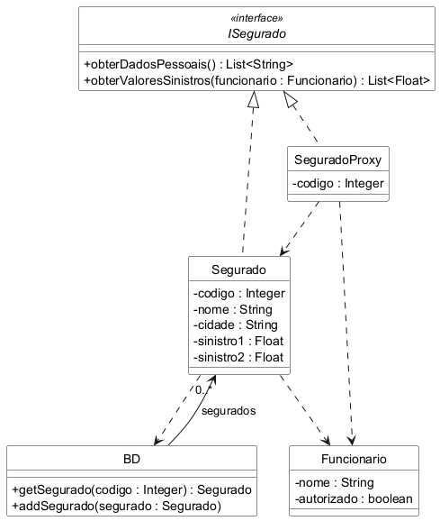

# Proxy

Trabalho da disciplina Aspectos Avançados em Engenharia de Software.

Exemplo do padrão Proxy em Java, com testes em JUnit 5. O tema é o mesmo da
seguradora usada nos trabalhos anteriores: qualquer funcionário pode ver os
dados pessoais de um segurado, mas os valores dos sinistros dele só podem ser
consultados por um funcionário autorizado.

O `SeguradoProxy` fica no lugar do segurado de verdade. Ele só busca o segurado
no banco quando alguém realmente pede os dados, e antes de mostrar os valores
dos sinistros confere se o funcionário tem autorização.

## Diagrama de classes

